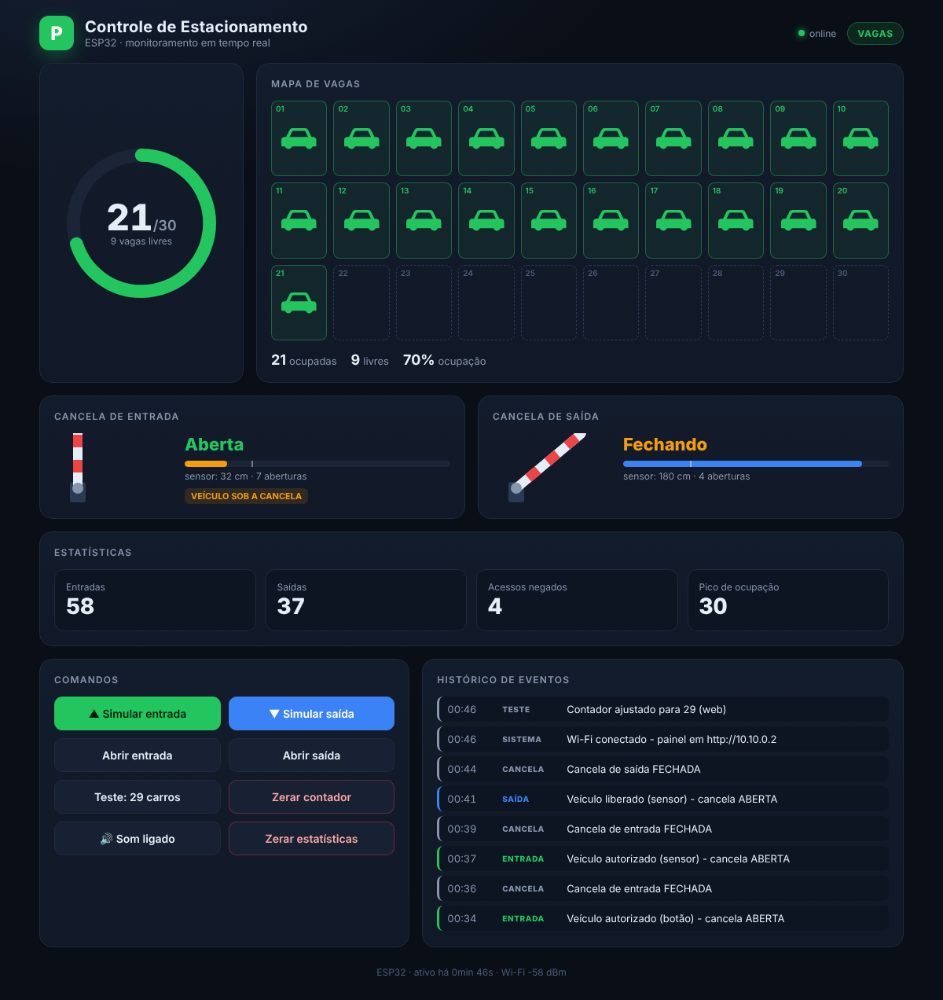

# 🚗 Versão completa (v2): LCD · HC-SR04 · Painel Web e extras

Parte da versão de referência e soma as **três atividades do roteiro**, mais alguns recursos extras.



## ✨ O que tem a mais

| | Recurso | Detalhes |
|---|---|---|
| 📟 | **LCD 16×2 I2C** *(Atividade 1)* | Ocupadas/livres, ícones das cancelas (aberta/fechada), avisos temporários (“BEM-VINDO!”, “ACESSO NEGADO”, IP do Wi-Fi) e tela de abertura. Só reescreve o que mudou, sem I2C desnecessário. |
| 📡 | **Sensores HC-SR04** *(Atividade 2)* | Eco medido **por interrupção**, sem `pulseIn()` bloqueante. Medição alternada entre os dois sensores, **histerese** (entra < 50 cm, sai > 70 cm) e **3 leituras seguidas** para confirmar, o que elimina ruído. |
| 🌐 | **Painel Web** *(Atividade 3)* | Página responsiva servida pelo próprio ESP32: anel de ocupação, mapa das 30 vagas, cancelas animadas, distância dos sensores, estatísticas, histórico e botões de comando. API JSON em `/api/estado`. |
| 🛡️ | **Cancela segura** | Não fecha com veículo embaixo e **reabre** se detectar veículo durante o fechamento. |
| 🎚️ | **Movimento suave** | Máquina de estados `FECHADA → ABRINDO → ABERTA → FECHANDO`, servo girando ~3° a cada 10 ms. |
| 🔊 | **Buzzer** | Sons diferentes para entrada, saída, negado, lotado e alerta. Sequenciador não bloqueante; dá para silenciar pelo serial ou pela web. |
| 💾 | **Persistência** | Contador e estatísticas salvos na flash (NVS) e restaurados após reiniciar. |
| 📜 | **Histórico** | Últimos 15 eventos em memória (serial `L` e painel web). |
| 🕹️ | **Botões manuais** | Continuam funcionando como acionamento do operador (teclas **E**/**S** no Wokwi). |

Tudo roda **sem `delay()` no loop**: botões, sensores, servos, buzzer, LCD, Wi-Fi e servidor web funcionam ao mesmo tempo.

## 📁 Arquivos

| Arquivo | Conteúdo |
|---|---|
| `sketch.ino` | Lógica principal: regras, LCD, NVS, serial, web, `setup()`/`loop()` |
| `componentes.h` | Tipos: `Botao`, `SensorUltrassonico`, `Cancela`, `Buzzer`, eventos |
| `config.h` | **Todos** os pinos, tempos, limiares e credenciais Wi-Fi |
| `pagina_web.h` | Painel web (HTML + CSS + JS, autocontido) |
| `diagram.json` | Circuito do Wokwi |
| `libraries.txt` | `ESP32Servo`, `LiquidCrystal I2C` |

## 🔌 Pinos

| Dispositivo | GPIO | Obs. |
|---|:-:|---|
| Botão ENTRADA / SAÍDA | 18 / 19 | INPUT_PULLUP, ligados ao GND |
| LCD I2C SDA / SCL | 21 / 22 | endereço `0x27` |
| LED verde / vermelho | **32 / 33** | mudaram de 21/22 para liberar o I2C |
| Servo entrada / saída | 25 / 26 | PWM 50 Hz |
| HC-SR04 entrada TRIG / ECHO | 13 / 14 | |
| HC-SR04 saída TRIG / ECHO | 27 / 34 | GPIO34 é só entrada, ideal para ECHO |
| Buzzer | 23 | passivo |

> ⚠️ **Montagem física:** o ECHO do HC-SR04 sai em 5 V. Use um divisor resistivo (ex.: 1 kΩ / 2 kΩ) antes do ESP32. Alimente os servos com fonte 5 V externa e **GND comum**.

## ▶️ Rodando no Wokwi

1. Crie um projeto **ESP32** no Wokwi.
2. Cole `sketch.ino` e `diagram.json`.
3. Crie os arquivos `config.h`, `componentes.h` e `pagina_web.h` (botão **+** ao lado das abas) e cole o conteúdo de cada um.
4. Adicione as bibliotecas **ESP32Servo** e **LiquidCrystal I2C** no Library Manager.
5. **Start Simulation**.

### Simulando um veículo com o sensor

Clique no HC-SR04 durante a simulação e arraste a distância:

1. **< 50 cm**: veículo chegou. Conta, abre a cancela e mostra o aviso no LCD.
2. Mantenha perto: a cancela **não fecha** (alerta “veículo sob a cancela”).
3. **> 70 cm**: veículo passou. A cancela fecha.

### Abrindo o painel web

O ESP32 conecta na rede `Wokwi-GUEST` e mostra o IP no serial e no LCD. Para abrir a página **pelo navegador**, o Wokwi exige o *Private IoT Gateway* (recurso do plano pago Wokwi Club): com ele rodando, acesse `http://localhost:9080`. Em um ESP32 real, basta trocar `WIFI_SSID`/`WIFI_SENHA` no `config.h` e abrir o IP mostrado (ou `http://estacionamento.local`).

## ⌨️ Comandos do monitor serial

| Tecla | Ação | Tecla | Ação |
|:-:|---|:-:|---|
| `E` | entrada manual | `S` | saída manual |
| `T` | contador = 29 | `R` | zera o contador |
| `?` | status completo | `L` | histórico de eventos |
| `W` | info do Wi-Fi | `M` | liga/desliga o som |
| `Z` | zera estatísticas | `H` | ajuda |

## 🔗 API

| Método | Rota | Descrição |
|---|---|---|
| `GET` | `/` | Painel web |
| `GET` | `/api/estado` | Estado completo em JSON |
| `POST` | `/api/comando` | `acao=` `entrada` · `saida` · `abrir_entrada` · `abrir_saida` · `teste` · `zerar` · `zerar_stats` · `som` |

Exemplo de `/api/estado`:

```json
{
  "veiculos": 21, "capacidade": 30, "livres": 9, "lotado": false,
  "cancelas": {
    "entrada": { "estado": "aberta", "aberta": true, "angulo": 90, "obstruida": true, "distancia": 32 },
    "saida":   { "estado": "fechada", "aberta": false, "angulo": 0, "obstruida": false, "distancia": 300 }
  },
  "stats": { "entradas": 58, "saidas": 37, "negados": 4, "pico": 30 },
  "eventos": [ { "t": 46, "tipo": "entrada", "msg": "Veículo autorizado (sensor) - cancela ABERTA" } ]
}
```

## 🔁 Diferenças de comportamento em relação à v1

- **Cada detecção conta um veículo.** Se um novo veículo chega com a cancela aberta, ele é contado e o tempo de 2,5 s recomeça. (Na v1 o pedido era ignorado enquanto a cancela estava aberta.)
- **O fechamento espera o veículo sair** do alcance do sensor (segurança).
- **O contador sobrevive a reinicializações** (`PERSISTIR_DADOS` em `config.h`; mude para `false` se quiser começar sempre do zero).
