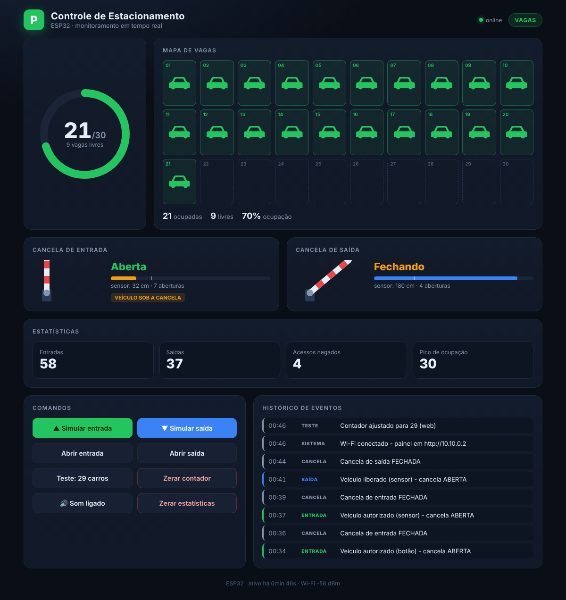

# 🅿️ Controle Automatizado de Estacionamento — ESP32

Sistema embarcado com **ESP32** que controla a entrada e a saída de veículos de um estacionamento com **30 vagas**: duas cancelas independentes (servos), sinalização por LEDs e monitor serial, simulado no **Wokwi**.

`ESP32 DevKit V1` · `C/C++ (Arduino)` · `Wokwi` · `ESP32Servo` · `LiquidCrystal I2C`



## 📦 Versões

| Pasta | O que é |
|---|---|
| [`01-referencia/`](01-referencia/) | **Versão de referência** do roteiro: botões, 2 servos, LEDs, contador 0–30, debounce de 40 ms, fechamento automático em 2,5 s com `millis()`, comandos `T`/`R` no serial. |
| [`02-versao-completa/`](02-versao-completa/) | **Versão completa (v2)**: tudo da referência + as 3 atividades (**LCD 16×2 I2C**, **sensores HC-SR04**, **painel Web via Wi-Fi**) + extras: 1 veículo por ciclo da cancela, sensor de segurança, movimento suave, buzzer, persistência na flash, histórico e API JSON. |
| [`testes/`](testes/) | Testes automatizados que rodam no PC (g++), simulando pinos, tempo, sensores, LCD e servidor web. |

## ✅ Requisitos atendidos

| Req. | Descrição | v1 | v2 |
|:-:|---|:-:|:-:|
| RF01 | 30 vagas | ✅ | ✅ |
| RF02 | Cancelas independentes de entrada e saída | ✅ | ✅ |
| RF03 | Bloqueia a entrada com 30 veículos | ✅ | ✅ |
| RF04/05 | LED vermelho = lotado · verde = há vagas | ✅ | ✅ |
| RF06/07 | +1 na entrada · −1 na saída | ✅ | ✅ |
| RF08 | Quantidade no monitor serial | ✅ | ✅ |
| RF09 | Contador sempre entre 0 e 30 | ✅ | ✅ |
| RF10 | Fecha sozinha após 2,5 s | ✅ | ✅ (espera o veículo sair) |
| RF11 | Um registro por acionamento | ✅ | ✅ |
| RF12 | Cancelas sem bloquear o processamento | ✅ | ✅ |
| Ativ. 1 | Display LCD I2C | — | ✅ |
| Ativ. 2 | Sensores HC-SR04 | — | ✅ |
| Ativ. 3 | Monitoramento Web | — | ✅ |

## 🧪 Testes

```bash
./testes/rodar.sh
```

Roda o plano de testes do roteiro (TF01–TF10) nas duas versões, mais os testes da v2: sensores, histerese, ruído, 1 veículo por ciclo, segurança da cancela, API web e persistência. Os testes validam a **lógica** no PC; o comportamento final deve ser conferido também na simulação do Wokwi.

## 🚀 Começando

Cada pasta tem seu próprio README com o passo a passo no Wokwi, o mapa de pinos e os comandos do serial.
